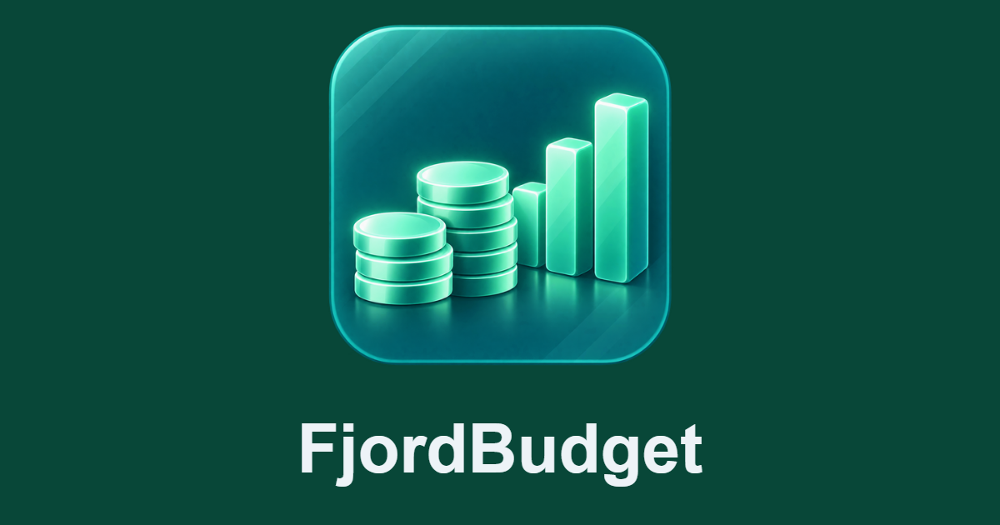

# FjordBudget



A personal budget app with account balances, booked transactions, categories, monthly budgets, spending analysis and savings goals. The interface currently uses Danish labels.

## Install through FjordHub

Choose **FjordBudget**, a port (default **8060**) and data directory. Open it from Hub for SSO or use the same account on the login page. The first administrator to sign in becomes the installation's permanent budget owner. Other users cannot access the owner's data, even with an app role. Use separate installations for independent owners.

Choose the public domain after installation in Hub's app settings. Use a dedicated HTTPS origin; subpath mounting is unsupported. The app retrieves the configured address with a maximum 30-second cache and shows the bank callback URL in Connect bank. Private LAN addresses work too. Forwarded host/protocol headers are not the trust basis.

[fjordhub.json](fjordhub.json) selects `docker-compose.fjordhub.yml`, requiring Hub configuration and current membership. Hub outages block protected requests. First-login email/password setup works inside the app. Removed access invalidates existing sessions. Administrators can centrally require an email update; opening or returning to any updated app presents a mandatory form until a valid, unique address is saved. Completion clears the shared requirement. Update Hub and Budget together.

## Local Docker Desktop demo

```sh
docker compose up -d --build
docker compose logs --tail 100 app
docker compose stop
docker compose start
```

Open `http://localhost:8060`. The demo contains fictional accounts and four months of transactions. My bank data opens a separate area; demo and real data are never mixed.

The desktop `compose.yaml` binds only `127.0.0.1:8060` and has no login. Use the Hub deployment for LAN/internet access. Never switch an exposed server deployment to `AUTH_MODE=local`.

## Read-only bank access

Enable Banking **Account Information Services (AIS)** reads accounts, balances and booked transactions. No payments are implemented; payment endpoints are rejected even if provider credentials permit them. POST starts consent/exchanges its authorization code; DELETE only disconnects read consent.

1. Create an application in [Enable Banking](https://enablebanking.com/cp/applications).
2. Use Sandbox for tests. Production access to your own accounts depends on provider approval, coverage, terms and any charges; not all banks/accounts are promised.
3. Register the exact callback. Local deployment uses `http://localhost:8060/bank/callback`; the Hub deployment displays its configured HTTPS callback. Do not expose the local unauthenticated deployment through a tunnel.
4. Enter the app ID and complete private RSA PEM key in Connect bank and save. No environment change/restart is needed; API credentials can be replaced later.
5. Credentials are encrypted in `/data/bank-credentials.enc`, with restricted permissions, and never returned to the browser. Saved credentials override optional `ENABLE_BANKING_APP_ID` and `secrets/enablebanking.pem` configuration.
6. Locally, use `localhost` rather than `127.0.0.1` so the callback cookie follows the redirect.
7. Select the bank and approve read access there. MitID and bank login take place outside FjordBudget.

Each new consent's first synchronization requests the **longest available history** (`strategy=longest`); the bank determines the actual range. A completion modal reports the oldest returned booking and resulting history. Later refreshes request the last 90 days when the previous fetch is at least 30 minutes old. Imported history remains, and Update balances works manually at any time.

Reconnect expired consent. A stable account hash preserves accounts, history and manual categories. Disconnect bank access revokes provider access and stops imports while retaining local data. Controlled provider responses validate the implementation; a live approval/import depends on actual credentials and consent.

References: [API](https://enablebanking.com/docs/api/reference/), [FAQ](https://enablebanking.com/docs/faq/), [quick start](https://enablebanking.com/docs/api/quick-start/alt).

## Transactions, categories and budgets

- Amounts are integer minor currency units, not floating-point values.
- DKK, EUR, SEK, NOK, GBP, USD, CHF and PLN are supported and summed separately without conversion.
- Balance is the latest retrieved bank balance, preferably booked balance, not a month-end forecast.
- Budgets are monthly category spending ceilings. Automatic proposals use up to 12 complete previous months, add 5% to average spending and round up to DKK 50. Review/edit before saving. Unmapped categories appear separately.
- Create, rename and delete categories with a replacement; map them to budget categories. New categories ask whether a merchant is required, and the setting remains editable. Without that requirement, transactions use the original bank description without forcing merchant selection.
- Transfers are excluded from income/expense analysis; check categorization, especially transfers between your own accounts.
- Deduplication uses `entry_reference` per account, otherwise date, amount, currency, text and occurrence number. Identical purchases remain distinct; later bank changes without stable references may need reconciliation.
- Pending/reserved transactions are not included, so displayed totals can differ from the bank balance.
- All pages are fetched before saving an account's import. An account failure preserves history and does not stop other accounts updating.

## Spending analysis and savings goals

Set merchants manually and select Remember for future entries. Rules match the normalized complete bank description; card abbreviations alone are not guessed. Original descriptions remain intact.

Goals have a target, saved amount and deadline. Optionally link an account to use its latest balance; the manual amount is retained if unlinked. One active goal appears on the overview. Monthly saving requirements are compared with historical disposable income and classified as realistic, tight, possible with changes, or unrealistic under current finances.

Savings suggestions use repeated purchases at learned merchants, not budget categories. Fixed-expense merchants and one-off purchases are excluded. The estimate uses one fewer visit per month, based on the median purchase amount and capped at half the monthly spending.

Use “Spring over denne måned” to exclude a merchant from one goal's savings calculations for the current calendar month. The next relevant opportunity replaces it when available. Skips persist across reloads and apply to the goal on the overview too; “Tag med igen” restores a suggestion. Next month, skipped merchants become eligible again. The selected analysis dates still determine the spending history. Nothing automatically changes budgets or transactions.

## Data and backup

The local `fjordbudget_budget_data` volume holds SQLite plus encryption/session keys. Bank session IDs and remote account IDs use Fernet; transactions and budget data are not encrypted as a whole database. Protect the disk and backups.

Back up the complete volume, `encryption.key`, `session.key`, `bank-credentials.enc` and any private API key in `secrets/`. Preserve data and keys together privately; the key in the same volume does not protect against access to that entire volume. Stop before a file-based copy. Ordinary stop/rebuild preserves data; `docker compose down -v` deletes it.

Login permits five attempts per five minutes per direct IP (per proxy behind a reverse proxy). Cookies are HttpOnly/SameSite and Secure on the configured HTTPS domain. Writes require CSRF; consent state is browser-bound, single-use and valid for 15 minutes. Host is checked against local operation or the configured origin. No external fonts, CDN scripts, analytics or payment APIs are used.

## Development and operations

Python 3.13, Flask, SQLite and plain HTML/CSS/JavaScript. Use one threaded Gunicorn worker: synchronization locks are process-local.

```sh
python -m pip install -r requirements.txt playwright
python -m playwright install chromium
python -m unittest discover -s tests -v
```

Temporary-database tests cover mobile navigation, categories, budgets, bank setup/errors, duplicates, identical purchases, currency isolation, consent, encrypted tokens and pagination.

Public [privacy](https://qlerup.github.io/fjordbudget/privacy.html) and [terms](https://qlerup.github.io/fjordbudget/terms.html) pages are also available at `/privacy` and `/terms` without login. Adapt them if operator/audience changes. Provider acceptance of localhost legal-page URLs is unverified; publish these pages separately if public URLs are required. GitHub Pages serves only `docs/`, without banking data/credentials/app code. Rebuild with `python scripts/build_public_pages.py`.

Artwork is in `static/logos/` and [branding/README.md](branding/README.md). Use Hub's updater for managed deployment. Preserve the entire data directory and original keys. The owner table migrates without changing bank data. Do not roll an exposed deployment back to an unauthenticated version.
